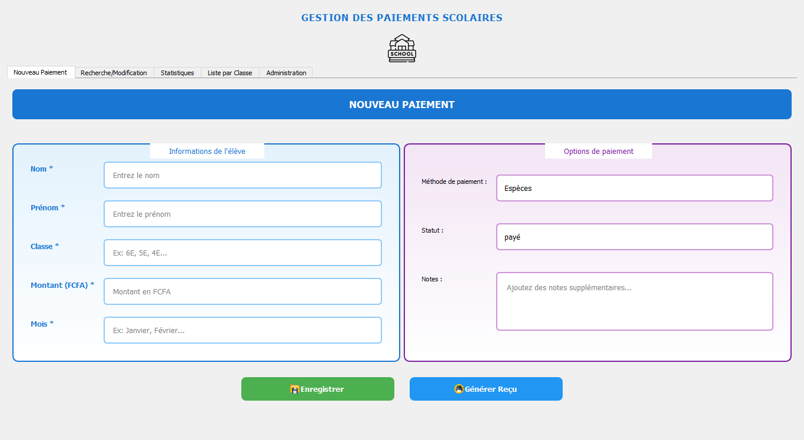
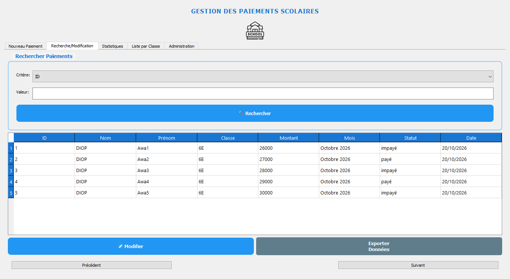
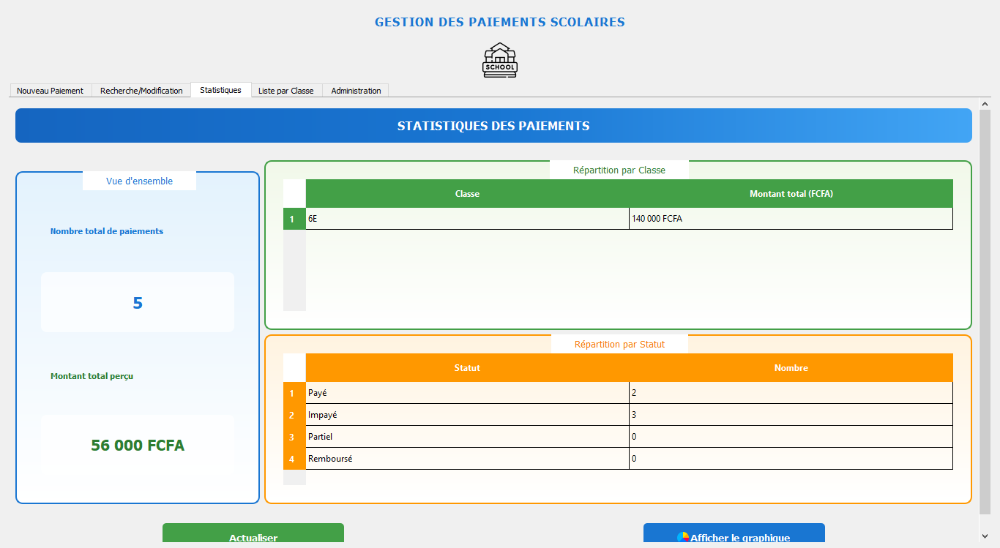
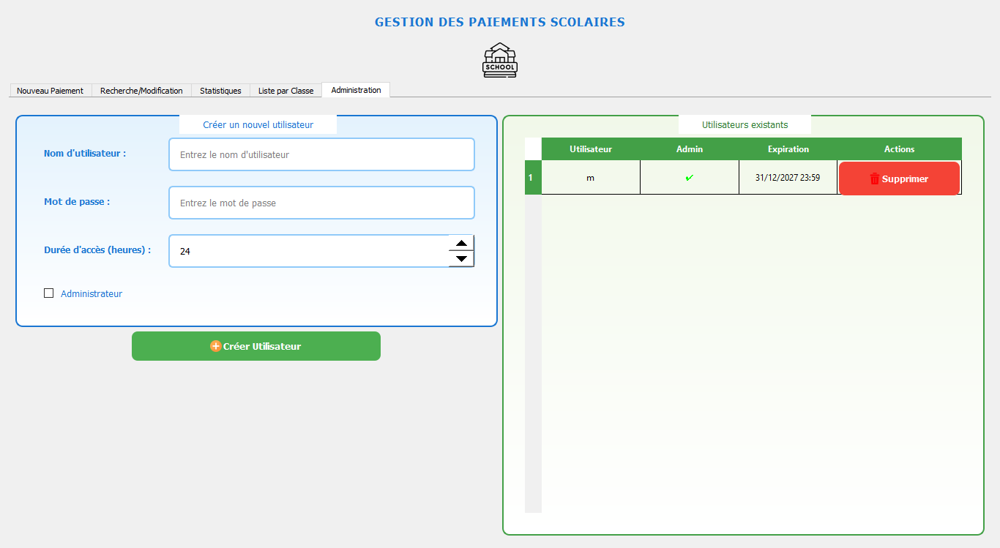

# 🎓 Gestion des Paiements Scolaires

Application de bureau **Python / PyQt5** pour gérer les paiements des élèves d'un établissement scolaire : saisie des paiements, recherche, statistiques, reçus, export et administration des comptes.

Fonctionne sur **Windows**, **Linux** et **macOS**, et s'adapte automatiquement à la taille de l'écran (petit portable, écran 4K, mise à l'échelle Windows 125 % / 150 %).


---

## 📑 Sommaire

- [Aperçu](#-aperçu)
- [Fonctionnalités](#-fonctionnalités)
- [Prérequis](#-prérequis)
- [Installation](#-installation)
- [Lancement](#-lancement)
- [Connexion](#-connexion)
- [Utilisation](#-utilisation)
- [Où sont stockées les données ?](#-où-sont-stockées-les-données-)
- [Interface adaptative](#-interface-adaptative)
- [Structure du projet](#-structure-du-projet)
- [Dépannage](#-dépannage)
- [Sécurité](#-sécurité)
- [Licence](#-licence)

---

## 🖼️ Aperçu

| Nouveau paiement | Recherche / modification |
|---|---|
|  |  |

| Statistiques | Administration |
|---|---|
|  |  |

---

## ✨ Fonctionnalités

- **Saisie des paiements** : nom, prénom, classe, montant, mois, méthode de paiement, statut et notes.
- **Recherche et modification** : par ID, nom, classe, mois ou statut, avec résultats paginés.
- **Statistiques** : total des paiements, montant total perçu, répartition par classe et par statut.
- **Graphique** : camembert de répartition des paiements (matplotlib).
- **Liste des élèves par classe** : filtre instantané sur la classe.
- **Reçus** :
  - reçu texte (`.txt`) généré depuis le formulaire ;
  - reçu **PDF** pour un paiement sélectionné dans les résultats.
- **Export CSV** de l'ensemble des paiements (`data/exports/`).
- **Sauvegarde automatique** : une copie datée du fichier de données est créée à chaque enregistrement (`data/backups/`).
- **Gestion des comptes** (onglet Administration) : création / suppression d'utilisateurs, droits administrateur, durée d'accès.
- **Notifications système** : alerte pour les paiements datant de plus de 30 jours.
- **Journalisation** dans `app.log` (utile en cas de problème).
- **Interface adaptative** : fenêtre dimensionnée selon l'écran, onglets défilables et jamais tronqués, formulaires qui passent d'une à deux colonnes, rendu net en haute résolution.

---

## 🔧 Prérequis

| Élément | Version |
|---|---|
| Python | **3.12 ou supérieur** (testé avec 3.12.10) |
| PyQt5 | 5.15.11 |
| matplotlib | 3.11.2 |
| numpy | 2.5.4 |
| reportlab | 5.1.0 |

> ℹ️ Ces versions sont épinglées dans `requirements.txt`. `numpy 2.5.4` exige Python ≥ 3.12 et `matplotlib 3.11` exige Python ≥ 3.11 : utilisez **Python 3.12** pour un fonctionnement garanti.

---

## 🚀 Installation

### 1. Récupérer le projet

```bash
git clone https://github.com/<votre-utilisateur>/App-gestion-paiement.git
cd App-gestion-paiement
```

Ou décompressez simplement l'archive du projet, puis ouvrez un terminal dans le dossier.

### 2. Créer un environnement virtuel

**Windows (PowerShell)**
```powershell
py -3.12 -m venv .venv
.\.venv\Scripts\Activate.ps1
```

**Linux / macOS**
```bash
python3.12 -m venv .venv
source .venv/bin/activate
```

> Si PowerShell bloque l'activation : `Set-ExecutionPolicy -Scope CurrentUser RemoteSigned`

### 3. Installer les dépendances

```bash
pip install --upgrade pip
pip install -r requirements.txt
```

---

## ▶️ Lancement

Toujours depuis le dossier du projet :

```bash
python main_gui.py
```

Sous Windows, pour démarrer **sans fenêtre noire** :

```powershell
.\.venv\Scripts\pythonw.exe main_gui.py
```

---

## 🔐 Connexion

Au premier démarrage, un compte administrateur est créé automatiquement :

| Utilisateur | Mot de passe |
|---|---|
| `admin` | `admin123` |

> 🔴 **Changez ce mot de passe** après la première connexion (onglet *Administration*).
>
> Les comptes possèdent une **durée d'accès** (24 h par défaut). Si le compte `admin` expire, il est **renouvelé automatiquement** au démarrage afin de ne jamais bloquer l'application.

---

## 🧭 Utilisation

### Onglet « Nouveau Paiement »
1. Renseignez les champs obligatoires (marqués `*`) : nom, prénom, classe, montant, mois.
2. Choisissez la méthode de paiement et le statut.
3. **Enregistrer** → le paiement est ajouté, les données sauvegardées et une copie de sécurité créée.
4. **Générer Reçu** → crée un fichier `recu_<NOM>_<Prenom>.txt`.

### Onglet « Recherche/Modification »
- Choisissez un critère (ID, nom, classe, mois, statut), saisissez une valeur, puis **Rechercher**.
- **Modifier** un paiement sélectionné, **Exporter Données** pour un CSV complet.
- La pagination (Précédent / Suivant) se trouve sous le tableau.

### Onglet « Statistiques »
- Totaux et répartitions mis à jour automatiquement.
- **Actualiser** recharge les chiffres, **Afficher le graphique** ouvre le camembert.

### Onglet « Liste par Classe »
- Tapez le début d'un nom de classe (ex. `6E`) : la liste se filtre à la frappe.

### Onglet « Administration » (comptes administrateurs uniquement)
- Créer un utilisateur (nom, mot de passe, durée d'accès en heures, case *Administrateur*).
- Supprimer un utilisateur — le compte `admin` est protégé.

---

## 💾 Où sont stockées les données ?

| Fichier / dossier | Contenu | Versionné sur Git ? |
|---|---|---|
| `data/paiements.csv` | Tous les paiements (lisible dans Excel) | ❌ généré |
| `data/utilisateurs.json` | Comptes et mots de passe | ❌ généré |
| `data/backups/` | Copies datées du CSV à chaque enregistrement | ❌ |
| `data/exports/` | Exports CSV générés par le bouton d'export | ❌ |
| `database.db` | Base SQLite initialisée au démarrage | ❌ généré |
| `app.log` | Journal d'exécution | ❌ généré |

> Les chemins sont **absolus**, calculés à partir du dossier du projet : l'application peut être lancée depuis n'importe quel répertoire.

---

## 📱 Interface adaptative

| Comportement | Détail |
|---|---|
| Taille de fenêtre | Calculée à partir de l'écran (92 % de la zone utile, 1500 × 980 px max) ; **maximisée** automatiquement si l'écran est plus petit que 1500 × 900 |
| Taille minimale | 720 × 520 px (ou la taille de l'écran si plus petit) |
| Onglets | Contenu **défilable** : plus rien n'est coupé sur un écran 768 px de haut |
| Barre d'onglets | Taille de police réduite (11 px), largeur calculée sur le libellé et **jamais tronquée** (`ElideNone`) : les 5 noms s'affichent en entier dès 800 px de large, avec flèches de défilement au-delà |
| Typographie | Échelle compacte (13 px pour les champs, 16–18 px pour les titres) afin que tous les libellés tiennent sans élargir la fenêtre |
| Formulaires | Deux colonnes au-dessus de 1180 px, **une seule colonne** en dessous (bascule en direct pendant le redimensionnement) |
| Tableaux | Colonnes étirées sur toute la largeur, en-têtes et lignes ajustés au contenu |
| Haute résolution | `AA_EnableHighDpiScaling` activé + pixmaps haute densité (écrans 4K, Retina, mise à l'échelle 125–200 % de Windows) |
| Dialogue statistiques | Taille limitée à 90 % de l'écran |

---

## 🗂️ Structure du projet

```
App-gestion-paiement/
├── main_gui.py              # Point d'entrée : interface, logique métier, authentification
├── models/
│   └── database.py          # Initialisation SQLite (paiements, users)
├── utils/
│   ├── config.py            # Chemins, cache, configuration de la journalisation
│   ├── cache.py             # Cache mémoire avec expiration (pagination)
│   ├── pagination.py        # Découpage en pages des résultats
│   ├── charts.py            # Génération du camembert (matplotlib)
│   ├── pdf_generator.py     # Reçus PDF (reportlab)
│   └── notifications.py     # Notifications système + alertes de retard
├── data/                    # Données utilisateur (paiements, comptes, sauvegardes, exports)
├── docs/captures/           # Captures d'écran pour ce README
├── icons/                   # Icônes de l'interface
├── requirements.txt
├── LICENSE                  # Licence MIT
└── README.md
```

---

## 🩺 Dépannage

| Symptôme | Cause probable | Solution |
|---|---|---|
| `python` ouvre le Microsoft Store | Python non installé (alias Windows) | Installer Python depuis [python.org](https://www.python.org/downloads/) ou `winget install Python.Python.3.12` |
| `ModuleNotFoundError: PyQt5` | Environnement virtuel non activé | `.\.venv\Scripts\Activate.ps1` puis réinstaller les dépendances |
| `No module named 'reportlab'` / `'numpy'` | Dépendances incomplètes | `pip install -r requirements.txt` |
| `Indique : impossible de charger le plugin de plateforme "windows"` | PyQt5 cassé | `pip install --force-reinstall PyQt5` |
| « Identifiants incorrects ou compte expiré » | Compte expiré | Redémarrer l'application (l'`admin` est renouvelé) ou supprimer `data/utilisateurs.json` |
| Impossible d'enregistrer un paiement | Dossier de sauvegarde absent | Il est recréé automatiquement ; sinon créer `data/backups/` |
| Caractères accentués illisibles | Fichier CSV ouvert avec le mauvais encodage | Ouvrir avec **UTF-8** dans Excel (Données → À partir d'un texte) |
| Interface trop grande / trop petite | Mise à l'échelle Windows | Clic droit sur `pythonw.exe` → Propriétés → Compatibilité → *Remplacer le comportement de mise à l'échelle PPP élevée* |

Les erreurs détaillées se trouvent dans `app.log`.

---

## ⚠️ Sécurité

- Les mots de passe sont stockés **en clair** dans `data/utilisateurs.json`, et `data/utilisateurs.json` contient un compte par défaut connu (`admin` / `admin123`).
- Le fichier `data/paiements.csv` contient des **données personnelles d'élèves** : ne le publiez pas sur GitHub (il est déjà exclu via `.gitignore`).
- Cette application est conçue pour un usage local mono-poste. Pour un usage en réseau ou multi-utilisateurs, remplacez la gestion de comptes par une authentification avec mots de passe hachés (bcrypt/argon2) et une base de données serveur.

---

## 📄 Licence

Ce projet est distribué sous licence **MIT** — logiciel libre et gratuit, usage personnel comme commercial autorisé (voir le fichier [LICENSE](LICENSE)).

En résumé, vous pouvez :

- ✅ utiliser le logiciel gratuitement, sans limite de durée ;
- ✅ le modifier et l'adapter à vos besoins ;
- ✅ le redistribuer ou le vendre ;

à condition de conserver l'avis de copyright et le texte de la licence.

Le logiciel est fourni « en l'état », sans garantie d'aucune sorte.
